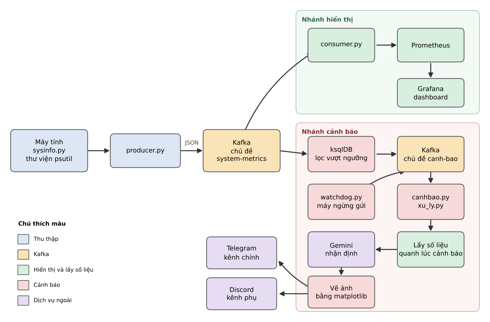

# Hệ thống giám sát tài nguyên theo thời gian thực và cảnh báo sự cố sử dụng Confluent Kafka

Đồ án tốt nghiệp. Hệ thống thu thập số liệu tài nguyên của máy tính, truyền qua Kafka, hiển thị trên Grafana và tự động cảnh báo khi có sự cố. Khi có cảnh báo, hệ thống nhờ trí tuệ nhân tạo Gemini nhận định, vẽ ảnh chụp số liệu và gửi qua Telegram, đồng thời gửi qua Discord.



## 1. Tính năng

- Thu thập CPU tổng, CPU từng luồng, tần số CPU, RAM, swap, dung lượng từng ổ đĩa, đọc ghi đĩa, tốc độ mạng, lỗi và gói rớt của card mạng, tiến trình tốn tài nguyên nhất, pin, thời gian chạy.
- Truyền số liệu qua Kafka mỗi 2 giây, hiển thị trên một dashboard Grafana.
- Phát hiện sự cố bằng ksqlDB, có 7 loại cảnh báo.
- Nhờ trí tuệ nhân tạo Gemini nhận định mức độ nghiêm trọng, nguyên nhân có thể và đề xuất xử lý.
- Vẽ ảnh cảnh báo gồm các biểu đồ quanh thời điểm sự cố, gửi qua Telegram và Discord.
- Chương trình canh gác phát hiện máy ngừng gửi số liệu.

## 2. Các loại cảnh báo

| Loại | Điều kiện | Giá trị trong tin nhắn |
| --- | --- | --- |
| CPU_CAO | CPU trên 90% | Phần trăm CPU |
| RAM_CAO | RAM trên 90% | Đã dùng trên tổng, gigabyte |
| DIA_DAY_C, DIA_DAY_D | Ổ C hoặc ổ D đã dùng trên 90% | Đã dùng trên tổng, gigabyte |
| SWAP_CAO | Swap trên 80% | Phần trăm swap |
| PIN_YEU | Pin dưới 20% và không cắm sạc | Phần trăm pin |
| GOI_ROT | Tổng gói rớt hai chiều trên 5 gói mỗi giây | Số gói rớt mỗi giây |
| MAT_DU_LIEU | Quá 30 giây không nhận số liệu từ máy | Số giây mất liên lạc |

Mỗi loại cảnh báo trên mỗi máy chỉ gửi một lần trong 5 phút.

## 3. Kiến trúc

Số liệu đi theo hai nhánh sau khi vào Kafka.

- Nhánh hiển thị: `consumer.py` đọc Kafka và mở các chỉ số ở cổng 8000, Prometheus thu thập mỗi 5 giây, Grafana hiển thị.
- Nhánh cảnh báo: ksqlDB lọc số liệu vượt ngưỡng và ghi vào chủ đề `canh-bao`. Chương trình `canhbao.py` đọc chủ đề này, lấy số liệu quanh thời điểm sự cố từ Prometheus, hỏi Gemini, vẽ ảnh và gửi đi.

ksqlDB chỉ phản ứng khi có bản ghi đến nên không tự phát hiện được việc máy ngừng gửi. Việc này do `watchdog.py` đảm nhiệm.

## 4. Cấu trúc thư mục

```text
DATN/
├── sysinfo.py             Đọc số liệu của máy bằng psutil
├── producer.py            Gửi số liệu vào chủ đề system-metrics
├── consumer.py            Đọc Kafka, mở chỉ số cho Prometheus ở cổng 8000
├── canhbao.py             Đọc chủ đề canh-bao, xử lý và gửi cảnh báo
├── xu_ly.py               Lấy số liệu, hỏi Gemini, vẽ ảnh, gửi tin
├── thu_thap.py            Truy vấn Prometheus lấy số liệu quanh thời điểm sự cố
├── ai_tom_tat.py          Tạo câu lệnh gửi Gemini và nhận nhận định
├── ve_anh.py              Vẽ ảnh cảnh báo bằng matplotlib
├── gui_tin.py             Gửi ảnh qua Telegram và Discord
├── watchdog.py            Phát hiện máy ngừng gửi số liệu
├── canhbao_thu.py         Chạy thử một loại cảnh báo
├── stresscpu.py           Tạo tải giả cho CPU
├── stressram.py           Tạo tải giả cho RAM
├── telegram_thu.py        Kiểm tra bot Telegram
├── telegram_chan_doan.py  Chẩn đoán bot Telegram
├── gemini_thu.py          Kiểm tra khóa Gemini
├── common/                Cấu hình và ghi nhật ký dùng chung
├── config.ini             Cấu hình chung
├── .env.example           Mẫu tệp biến môi trường
├── docker-compose.yml     Kafka, Prometheus, Grafana, ksqlDB
├── prometheus.yml         Cấu hình Prometheus
├── grafana_giam_sat_tong_hop.json   Dashboard Grafana
└── requirements.txt       Thư viện Python
```

## 5. Yêu cầu

- Python 3.10 trở lên.
- Docker Desktop.
- Một bot Telegram và khóa Gemini. Kênh Discord là tùy chọn.

## 6. Cài đặt và chạy

### Bước 1: Môi trường Python

```powershell
python -m venv myenv
.\myenv\Scripts\Activate.ps1
pip install -r requirements.txt
```

### Bước 2: Tệp `.env`

Sao chép `.env.example` thành `.env` rồi điền giá trị thật. Không đưa tệp `.env` lên GitHub.

```env
TELEGRAM_BOT_TOKEN=
TELEGRAM_CHAT_ID=
GEMINI_API_KEY=
DISCORD_WEBHOOK_URL=
```

- Tạo bot Telegram qua BotFather để lấy `TELEGRAM_BOT_TOKEN`.
- Mở bot trong Telegram và gửi một tin bất kỳ, rồi chạy `python telegram_thu.py`. Chương trình in ra mã cuộc trò chuyện để điền vào `TELEGRAM_CHAT_ID` và gửi một tin thử.
- Lấy khóa Gemini ở Google AI Studio, kiểm tra bằng `python gemini_thu.py`.

### Bước 3: Khởi động Kafka, Prometheus, Grafana, ksqlDB

```powershell
docker compose up -d
docker compose ps
```

Các dịch vụ mở tại Kafka `localhost:9092`, Prometheus `http://localhost:9090`, Grafana `http://localhost:3000`, ksqlDB `http://localhost:8088`.

### Bước 4: Tạo luật cảnh báo trong ksqlDB

Mở ksqlDB CLI:

```powershell
docker compose exec ksqldb-cli ksql http://ksqldb-server:8088
```

Dán lần lượt các câu lệnh sau.

```sql
CREATE STREAM so_lieu (thoi_gian VARCHAR, host VARCHAR, cpu DOUBLE, ram DOUBLE)
  WITH (KAFKA_TOPIC='system-metrics', VALUE_FORMAT='JSON');

CREATE STREAM canh_bao WITH (KAFKA_TOPIC='canh-bao', VALUE_FORMAT='JSON') AS
  SELECT host, 'RAM_CAO' AS loai, ram AS gia_tri, thoi_gian
  FROM so_lieu WHERE ram > 90 EMIT CHANGES;

INSERT INTO canh_bao SELECT host, 'CPU_CAO' AS loai, cpu AS gia_tri, thoi_gian
  FROM so_lieu WHERE cpu > 90;

CREATE STREAM so_lieu_mo_rong (
  thoi_gian VARCHAR, host VARCHAR, swap DOUBLE,
  disk MAP<VARCHAR, DOUBLE>,
  pin STRUCT<phan_tram DOUBLE, cam_sac INT>
) WITH (KAFKA_TOPIC='system-metrics', VALUE_FORMAT='JSON');

INSERT INTO canh_bao SELECT host, 'DIA_DAY_C' AS loai, disk['C:'] AS gia_tri, thoi_gian
  FROM so_lieu_mo_rong WHERE disk['C:'] > 90;

INSERT INTO canh_bao SELECT host, 'DIA_DAY_D' AS loai, disk['D:'] AS gia_tri, thoi_gian
  FROM so_lieu_mo_rong WHERE disk['D:'] > 90;

INSERT INTO canh_bao SELECT host, 'SWAP_CAO' AS loai, swap AS gia_tri, thoi_gian
  FROM so_lieu_mo_rong WHERE swap > 80;

INSERT INTO canh_bao SELECT host, 'PIN_YEU' AS loai, pin->phan_tram AS gia_tri, thoi_gian
  FROM so_lieu_mo_rong WHERE pin->phan_tram < 20 AND pin->cam_sac = 0;

CREATE STREAM so_lieu_mang (
  thoi_gian VARCHAR, host VARCHAR,
  net_loi STRUCT<rot_vao DOUBLE, rot_ra DOUBLE>
) WITH (KAFKA_TOPIC='system-metrics', VALUE_FORMAT='JSON');

INSERT INTO canh_bao SELECT host, 'GOI_ROT' AS loai,
  net_loi->rot_vao + net_loi->rot_ra AS gia_tri, thoi_gian
  FROM so_lieu_mang WHERE net_loi->rot_vao + net_loi->rot_ra > 5;
```

Kiểm tra bằng `SHOW QUERIES;`. Gõ `exit` để thoát.

Lưu ý: khi chạy `docker compose down` và `up` lại thì các luồng trong ksqlDB bị mất, cần dán lại các câu lệnh trên.

### Bước 5: Chạy các chương trình Python

Mỗi lệnh chạy trong một cửa sổ terminal riêng.

```powershell
python consumer.py
python producer.py
python canhbao.py
python watchdog.py
```

### Bước 6: Dashboard Grafana

1. Mở `http://localhost:3000`, thêm nguồn dữ liệu Prometheus với địa chỉ `http://prometheus:9090`.
2. Chọn Dashboards, New, Import, tải tệp `grafana_giam_sat_tong_hop.json` và chọn nguồn dữ liệu Prometheus vừa thêm.

## 7. Cấu hình

Tệp `config.ini` chứa các tham số chính.

- `PRODUCER chu_ky`: chu kỳ gửi số liệu, mặc định 2 giây.
- `CANHBAO khoang_nghi`: thời gian nghỉ giữa hai cảnh báo cùng loại, mặc định 300 giây.
- `PROMETHEUS cua_so_giay`, `sau_canh_bao_giay`, `doi_toi_giay`: khoảng thời gian lấy số liệu quanh sự cố và thời gian chờ để Prometheus có đủ số liệu.
- `AI cac_mo_hinh`: danh sách mô hình Gemini, thử lần lượt khi gặp lỗi.
- `ANH nguong`, `nguong_swap`, `nguong_pin`, `nguong_rot`: đường ngưỡng vẽ trong ảnh.
- `WATCHDOG chu_ky_giay`, `mat_du_lieu_giay`: chu kỳ kiểm tra và ngưỡng báo mất dữ liệu.

Ngưỡng quyết định khi nào báo nằm ở các câu lệnh ksqlDB, còn ngưỡng trong `config.ini` chỉ dùng để vẽ ảnh. Muốn đổi ngưỡng cần sửa cả hai nơi.

## 8. Kiểm thử

Chạy thử một loại cảnh báo mà không cần gây sự cố thật. Ảnh gửi đi có nhãn CHẠY THỬ.

```powershell
python canhbao_thu.py CPU_CAO
python canhbao_thu.py RAM_CAO
python canhbao_thu.py DIA_DAY_C
python canhbao_thu.py GOI_ROT
```

Tạo sự cố thật bằng tải giả.

```powershell
python stresscpu.py
python stressram.py
```

Thử cảnh báo mất dữ liệu: để `watchdog.py` và `canhbao.py` chạy, tắt `producer.py` hơn 30 giây.

## 9. Hạn chế

- ksqlDB báo ngay lần đầu vượt ngưỡng nên ảnh cảnh báo chủ yếu thấy phần đầu của đợt vượt ngưỡng.
- Luật ổ đĩa đang cố định cho ổ C và D.
- Mới thử trên một máy và một nút Kafka.
- Số liệu và tên tiến trình được gửi tới dịch vụ Gemini của Google khi có cảnh báo.

## 10. Dừng hệ thống

Nhấn Ctrl+C ở các cửa sổ đang chạy chương trình Python, rồi tắt các dịch vụ.

```powershell
docker compose down
```
